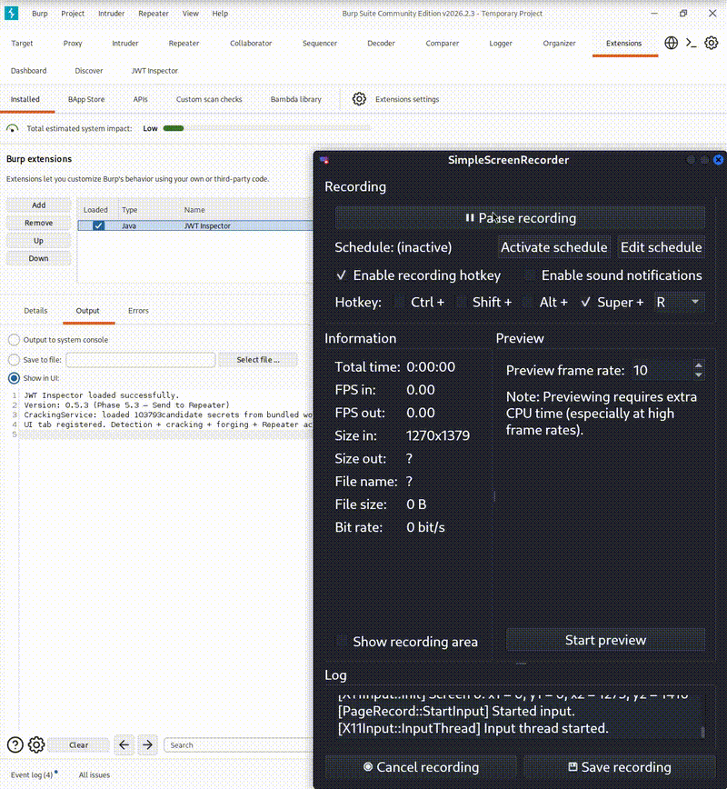
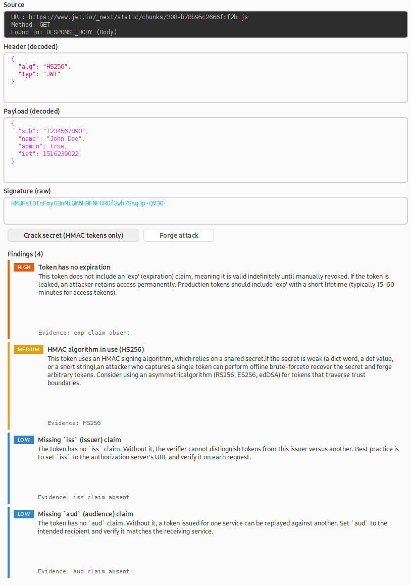
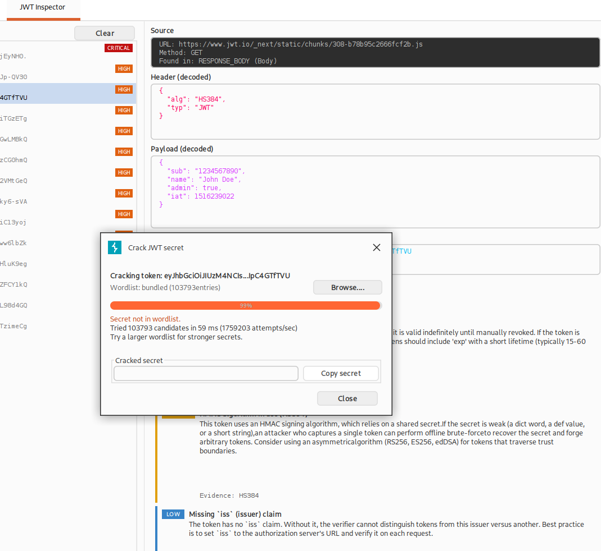
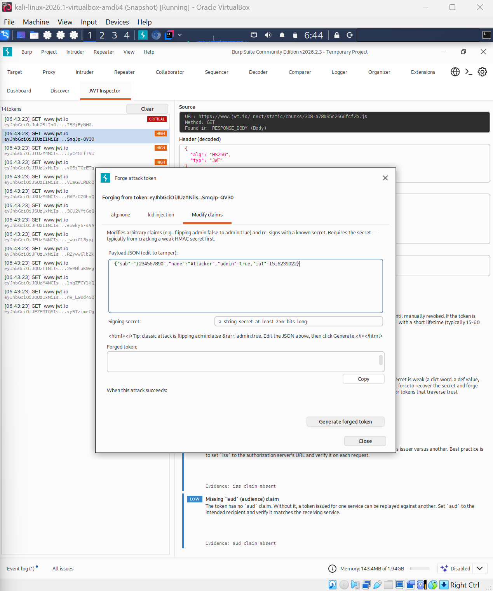
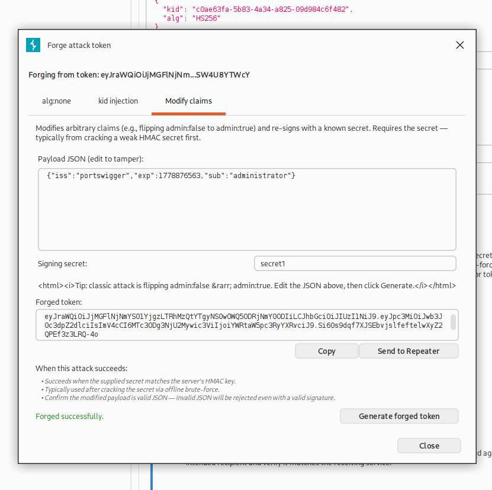
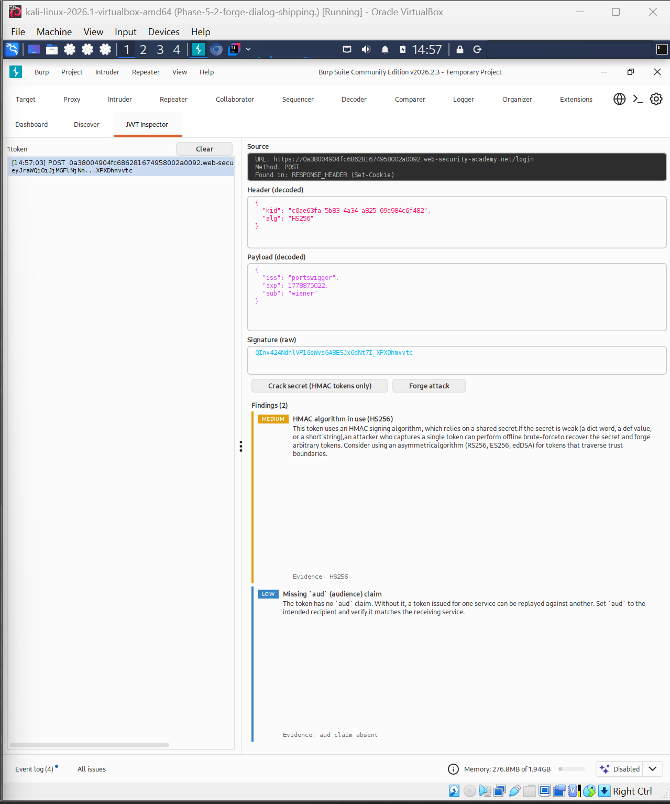

 

# Burp JWT Inspector

A Burp Suite extension that automates the full JWT attack chain — **detect, analyse, crack, forge, verify, replay** — from inside the proxy. Designed to take the friction out of JWT security testing and to teach as it goes.



*Forged session cookie accepted by the PortSwigger Web Security Academy "JWT authentication bypass via weak signing key" lab — full chain executed through the extension's UI.*

---

## What it does

- **Passively detects** JWTs in every request and response Burp proxies — Authorization headers, Cookie headers, custom auth headers, query parameters, request bodies, response bodies.
- **Analyses** every token against six vulnerability checks with severity-ranked findings: `alg:none`, weak algorithm, missing expiration, long lifetime, `kid` injection patterns, missing standard claims.
- **Cracks** HMAC secrets offline at over a million attempts per second against a bundled 103,793-entry wordlist of real-world leaks (Wallarm's `jwt.secrets.list` merged with framework defaults). Custom wordlists supported via the Browse button.
- **Forges** five attacks from any detected token:
  - `alg:none` signature stripping
  - `kid` header injection (path traversal, SQL and shell payloads)
  - claim tampering, re-signed with a known (typically cracked) HMAC secret
  - **algorithm confusion** (RS256 → HS256), with one-click **JWKS auto-fetch** of the server's public key
  - **JWK header injection**, signing with a generated key pair and embedding its public half in the header
- **Verifies** each forged token against the live server: it replays the forged token next to the real one and reports **ACCEPTED**, **REJECTED** or **INCONCLUSIVE** from the difference between the responses, instead of assuming HTTP 200 means success.
- **Replays** forged tokens straight into Burp's Repeater with one click, substituting the forged token wherever the original was observed (Authorization header, cookie, custom header or body).

## Why this exists

Existing Burp extensions for JWT analysis (notably PortSwigger's "JWT Editor") cover encoding and signing well but require the operator to manually orchestrate the workflow: copy a token out, paste into a cracker, copy the secret back, hand-edit claims, paste back into Repeater.

This extension collapses that workflow into the proxy. Token detection is automatic, analysis surfaces findings against the standard JWT vulnerability classes, cracking and forging are wired together so the cracked secret pre-fills the forge dialog, and the forged token can be sent to Repeater in one click. A built-in oracle then confirms whether the server actually accepted it. The goal is to reduce a 5-minute attack chain to under 30 seconds and to let the operator concentrate on the target rather than the tooling.

The findings panel and forge dialog also include short pedagogical notes — *when* each attack works, what server behaviour it targets — so the tool functions as a learning resource as well as an attack utility.

## Screenshots

### JWT Inspector tab
Detection, decoded header/payload/signature, severity-ranked findings, action buttons.



### Crack dialog
Off-EDT cracking with live progress, attempts per second, and cancellation. The screenshot shows 103,793 candidates exhausted in 59 milliseconds against an HS384 token (1.76M attempts/sec on a Kali VM with 4 cores).



### Forge dialog
Five tabs, one per attack, each with Generate, Copy, Send to Repeater and **Verify on server**. The Modify claims tab pre-fills with the original payload and the cracked secret (if available), so the user can edit a single claim and re-sign in seconds.



### Send to Repeater
One-click replay: the forged token is substituted into the original request's auth surface (Authorization header, session cookie, or custom location) and a named Repeater tab is opened.



---

## Quickstart

### Requirements
- Burp Suite Community or Professional 2024.x or later (Montoya API)
- Java 21+ (for building from source only — the prebuilt JAR runs on Burp's bundled JRE)

### Run the prebuilt JAR

1. Download `jwt-inspector-1.1.0.jar` from the [Releases](../../releases) page.
2. In Burp: *Extensions → Installed → Add → Java →* select the JAR.
3. Confirm the *Output* tab shows `JWT Inspector 1.1.0 loaded successfully.`, followed by the loaded checks and attacks.
4. A new top-level tab `JWT Inspector` appears.

### Build from source

```bash
git clone https://github.com/Tauqeerkhan187/burp-jwt-inspector.git
cd burp-jwt-inspector
./gradlew clean build
# Output: build/libs/burp-jwt-inspector-1.1.0.jar
```

The build uses Gradle Kotlin DSL with the Shadow plugin to produce a self-contained JAR, including Nimbus JOSE+JWT 10.0.2 and the bundled wordlist.

### Use it

1. Browse a JWT-using site through Burp's proxy.
2. Open the *JWT Inspector* tab. Detected tokens appear in the left list with a severity badge derived from the worst finding.
3. Click a token. The detail panel shows the decoded header, payload and signature, plus the findings.
4. **Crack secret**: opens the cracking dialog (HMAC tokens only). The bundled wordlist runs to completion in under a second on most hardware.
5. **Forge attack**: opens the five-tab forging dialog. On the alg-confusion tab, **Fetch key from server** fills in the server's public key.
6. **Verify on server**: replays the forged token next to the real one and reports the verdict. Use a token captured in a *request* to a protected page (for example `GET /my-account`), not one from a login response.
7. **Send to Repeater**: opens the forged request in Repeater for further manual testing.

---

## Architecture

```text
src/main/java/com/tk/jwtinspector/
├── JWTInspectorExtension.java        BurpExtension entry point; wires subsystems
├── detection/
│   ├── DetectedToken.java            Record: token + source + originating HttpRequest
│   ├── JWTDetector.java              Regex + Nimbus structural validation
│   ├── ProxyHttpHandler.java         Read-only proxy hook (request + response)
│   └── TokenStore.java               Dedup, EDT-safe listeners, cracked-secret cache
└── detection/analysis/
    ├── Finding.java, Severity.java   Finding record and severity scale
    ├── VulnerabilityCheck.java       Stateless interface; never throws
    ├── TokenAnalyzer.java            Runs all checks; severity-sorted findings
    ├── checks/                       AlgNone, WeakAlgorithm, MissingExpiration,
    │                                 LongLifetime, KidInjection, MissingClaims
    ├── crack/
    │   ├── CrackResult.java          FOUND / NOT_FOUND / CANCELLED / ERROR
    │   ├── WordlistLoader.java       Bundled and user-supplied wordlists
    │   ├── SecretCracker.java        Parallel javax.crypto.Mac, constant-time compare
    │   └── CrackingService.java      Holds wordlist; factory for crackers
    ├── forge/
    │   ├── ForgeAttack.java          ALG_NONE, KID_INJECTION, CLAIM_TAMPER,
    │   │                             ALG_CONFUSION, JWK_INJECTION
    │   ├── ForgedToken.java          Record with success/warnings/error
    │   ├── JwtHeader.java            Parse / edit / re-encode headers as JSON
    │   └── TokenForger.java          Stateless forging engine
    ├── jwks/
    │   ├── JwksKeys.java             JWKS URLs, kid-matched key selection, JWK → PEM
    │   └── JwksFetcher.java          Downloads a JWKS through Burp
    └── verify/
        ├── VerdictClassifier.java    Pure accept/reject decision logic
        ├── ForgeVerifier.java        Replays baseline + forged requests through Burp
        └── VerificationResult.java   Verdict + status codes + body sizes

src/main/java/com/tk/jwtinspector/ui/
├── JWTInspectorTab.java              Top-level tab; split pane
├── TokenListPanel.java               Left list with severity badges
├── TokenDetailPanel.java             Right detail view; owns action buttons
├── FindingsPanel.java                Severity-coloured finding cards
├── CrackDialog.java                  SwingWorker progress dialog
├── ForgeDialog.java                  Five-tab forge dialog: Repeater, Verify, JWKS fetch
└── WidthTrackingPanel.java           Scrollable panel so tab content never collapses

src/test/java/                         36 JUnit 5 tests (see Testing)

src/main/resources/
├── META-INF/services/burp.api.montoya.BurpExtension
└── wordlists/jwt-secrets-combined.txt   103,793 entries
```

### Notable engineering decisions

- **Read-only proxy hook.** `ProxyHttpHandler` returns `continueWith` for every request and response. The extension never modifies, drops, or intercepts live traffic — it observes and copies relevant data into the UI store.

- **`javax.crypto.Mac` rather than Nimbus' `MACVerifier` for cracking.** Nimbus' verifier enforces RFC 7518 minimum key sizes (32 bytes for HS256), which rejects short candidate secrets like `secret` before they're even tested. Cracking uses raw `Mac` so short HMAC keys go through. The signing input and target signature are computed once per token; only the MAC re-keying happens per candidate.

- **Parallel cracking with constant-time comparison.** `Runtime.getRuntime().availableProcessors()` workers each maintain their own `Mac` instance and use `MessageDigest.isEqual` to defeat timing side-channels in the final compare. Measured ~1.76M attempts/sec on a 4-core Kali VM.

- **JSON-based header editing, not regex.** Headers are parsed, edited and re-serialised through Nimbus' `JSONObjectUtils` (`JwtHeader`). An earlier regex approach passed user-supplied `kid` values into `Matcher` replacement strings, where `$` and `\` are special, so the tool's own suggested `$(id)` payload crashed the forge. Re-serialising can change key order, which is harmless because every modified header is re-signed (or, for `alg:none`, carries no signature).

- **A differential oracle, not "200 means success".** A forged token that fails often still gets HTTP 200, with the logged-out version of the page. `ForgeVerifier` replays the real token as a baseline and the forged token as the attack, then `VerdictClassifier` compares status codes and body sizes. A baseline that isn't a 2xx page (for example a login redirect) is reported as INCONCLUSIVE, because matching responses from an endpoint that never checks the token prove nothing.

- **Pure logic separated from Burp-facing code.** Montoya is `compileOnly` and isn't available to tests, so decision logic lives in classes with no Burp dependency (`TokenForger`, `JwtHeader`, `VerdictClassifier`, `JwksKeys`). Burp-facing classes (`ForgeVerifier`, `JwksFetcher`) only do the network calls. This is what makes the forging, oracle and JWKS logic unit-testable.

- **JWKS key selection refuses to guess.** It uses the key whose `kid` matches the token, or the only key if there's exactly one. If several keys exist and none match, it reports an error, because a wrong key gives a forged token that always fails, and that's harder to diagnose than an error message.

- **JWK injection embeds only the public key.** The attacker key pair is generated by the tool, and only its public half goes into the `jwk` header. A test asserts this, and verifies the forged signature against the embedded key, the same way a vulnerable server would.
-
- **SwingWorker for cracking off the EDT.** The cracker reports progress via `publish()`, the dialog renders attempts/sec live, and Cancel works through cooperative cancellation that checks an `AtomicBoolean` between candidates.

- **`HttpRequest` capture for Repeater integration.** Each `DetectedToken` carries the request it rode on (for request-side detections) or the request that triggered the response containing it (for response-side detections). The Forge dialog uses this to construct a replay request with the forged token spliced into the original auth surface — Authorization header, session cookie, custom header, or body.

### Testing

36 JUnit 5 tests run on every push via GitHub Actions:

- **Forging** (`TokenForgerTest`, 12): known-answer tests for all five attacks. Every forged signature is checked against the key the server would use, including a regression test for the `$(id)` kid crash.
- **Oracle** (`VerdictClassifierTest`, 8): accepted, rejected and inconclusive cases, including a 200 that serves a logged-out page and a redirect baseline.
- **JWKS** (`JwksKeysTest`, 7): URL construction, kid matching, and a JWK → PEM → key round trip that must match byte for byte.
- **Detection** (`JWTDetectorTest`, 6) and **cracking** (`SecretCrackerTest`, 3), including an RS256 token that must not be treated as crackable.

Run them with `./gradlew test`.

---

## Demo: PortSwigger Web Security Academy lab

The tool was validated end-to-end against PortSwigger's [**JWT authentication bypass via weak signing key**](https://portswigger.net/web-security/jwt/lab-jwt-authentication-bypass-via-weak-signing-key) lab (Practitioner tier). The full chain from detection to admin-panel access ran through the extension UI:

1. Logged into the lab as `wiener:peter`. The session JWT was detected automatically and appeared in the JWT Inspector tab.

   

2. Clicked **Crack secret**. The lab's signing key (`secret1`) was found in the bundled wordlist in roughly 30 ms.

3. Clicked **Forge attack → Modify claims**. The original payload was pre-filled. Edited `"sub":"wiener"` to `"sub":"administrator"`. Clicked **Generate**. The cracked secret was already in the signing field. The forged token appeared in monospace.

4. Clicked **Send to Repeater**. A new Repeater tab opened, named `JWT Inspector: Claim tampering`, with the forged token spliced into the session cookie.

5. In Repeater, changed the path from `/my-account` to `/admin`. **HTTP/2 200 OK** with the full admin panel HTML returned.

6. Changed path to `/admin/delete?username=carlos`. The lab marked the user as deleted and flipped to **Solved**.

Total time from clean lab to solved status: under one minute. Total clicks inside the extension UI: five.

---

## Limitations and future work

This is a deliberately bounded portfolio project. Known limits and roadmap items:

- **HMAC only for cracking.** RSA and EC keys can't be recovered from a wordlist. RS256 tokens are covered by attacks that don't need the private key instead: algorithm confusion and JWK header injection.
- **No JKU or x5u injection.** These point the server at a key hosted somewhere else, so they need a server you control. They aren't built, and there's no finding that flags `jku`/`jwk`/`x5u` headers yet.
- **JWKS fetch needs an exposed key.** If the server doesn't publish a JWKS, the public key has to be recovered from two captured tokens (the `rsa_sign2n` technique). That isn't implemented.
- **The oracle needs the right token.** Verification is meaningful for a token captured in a *request* to a protected endpoint. For a token captured from a login response, the replayed request never checks the token, and the oracle reports INCONCLUSIVE.
- **Wordlist is fixed at startup.** A "Reload wordlist" button is on the roadmap; restart Burp to pick up a new bundled list. Browse-to-load works at any time.
- **Repeater integration is heuristic.** The token substitution handles Authorization headers, cookies, custom auth headers and bodies, but unusual placements (for example base64-wrapped tokens inside a custom envelope) need manual editing in Repeater.
- **No "Solved badge" automation.** The lab demos needed one manual path change in Repeater (`/my-account` → `/admin`). Auto-rewriting the path adds little for real engagements.

## Tech stack

- **Java 21**, Gradle Kotlin DSL, Shadow plugin for fat JAR packaging
- **Montoya API** 2024.12 (Burp Suite extension SDK)
- **Nimbus JOSE+JWT** 10.0.2 (CVE-2025-53864-patched) for structural JWT validation
- **Standard `javax.crypto`** for MAC primitives
- **Swing** for the UI (Burp's native L&F)
- **JUnit 5** for the test suite
- **GitHub Actions** for CI on every push

## Author

Built by **Tauqeer Khan** as a portfolio piece for a Bachelor's in Cybersecurity. Reach out: [LinkedIn](https://www.linkedin.com/in/tauqeer-khan-462385243/).

## Licence

MIT. See `LICENSE`.
